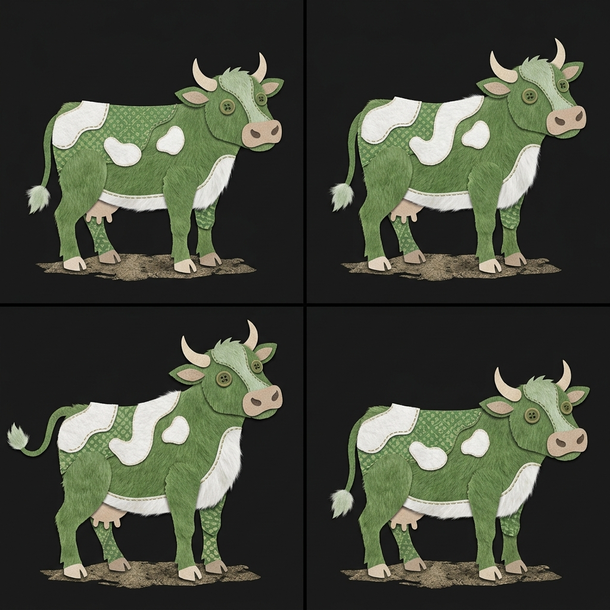
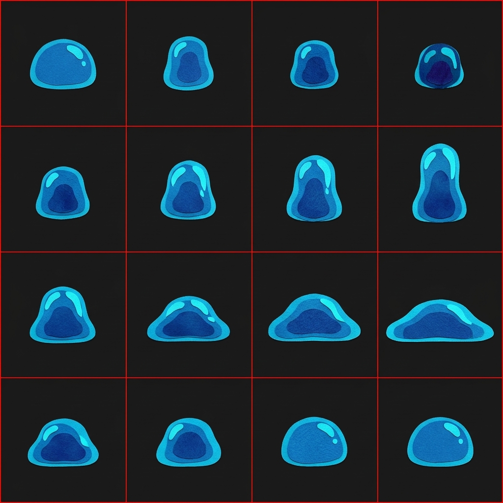

# Sprite Sheet Experiment — Favorites

## Best Art Styles

### Gemini Flash text-only — Cow

- Model: `gemini-3.1-flash-image-preview` (direct API)
- No template, no system instruction
- Prompt: `2x2 grid sprite sheet with 4 animation frames, each frame centered in its own quadrant, medium cow made of fur, green with white accents, mixed media collage style paper cutout, 4-frame idle breathing animation, consistent character across all 4 frames, solid #1a1a1a background in every quadrant, no text`
- Result: Beautiful mixed-media paper cutout with visible newspaper/book page textures, button details, stitching. Rich craft aesthetic.

### Gemini Flash + template — Slime

- Model: `gemini-3.1-flash-image-preview` (direct API)
- 4x4 template with system instruction
- Prompt: `Animation: a blue slime blob idle breathing, mixed media collage paper cutout style, blue with cyan accents`
- Result: 16 frames showing the slime morphing through different shapes — compressed, stretched, tall, flat. Translucent gel look with cyan highlights on dark background.

## What we like about these
- Mixed media collage / paper craft texture (newspaper, cardboard, fabric visible in the material)
- Dark background (#1a1a1a)
- Handmade feel — buttons, stitching, torn paper edges
- Rich color with visible material variation within the character
